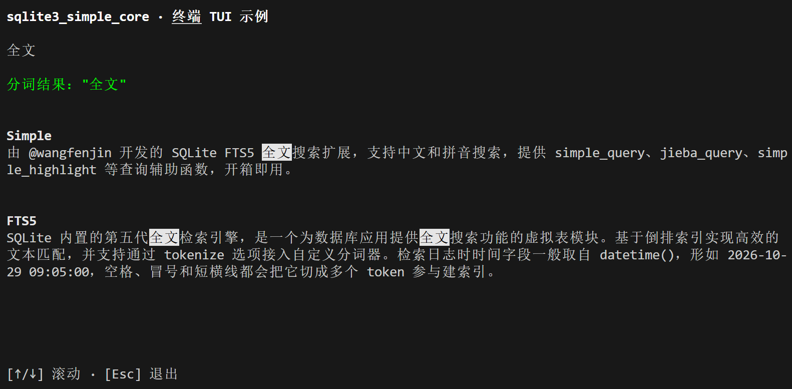
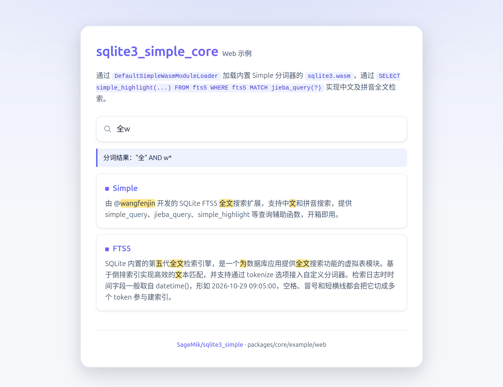

# sqlite3_simple_core

 

基于 [Simple](https://github.com/wangfenjin/simple) (支持中文和拼音的 SQLite FTS5 全文搜索扩展) 和 [sqlite3.dart](https://github.com/simolus3/sqlite3.dart) 的 Dart 库，用于 SQLite 中文和拼音全文搜索。

阅读 [`sqlite3_simple`](../flutter) 的文档，或者 [`example/bin`](example/bin) TUI 示例 和 [`example/web`](example/web) Web 示例，了解使用方法。

在 [`example`](example) 目录下执行 `dart run bin/main.dart` 运行 TUI 示例，执行 `dart tool/serve.dart` 运行 Web 示例：

| Dart TUI                           | Dart Web                           |
|------------------------------------|------------------------------------|
|  |  |
